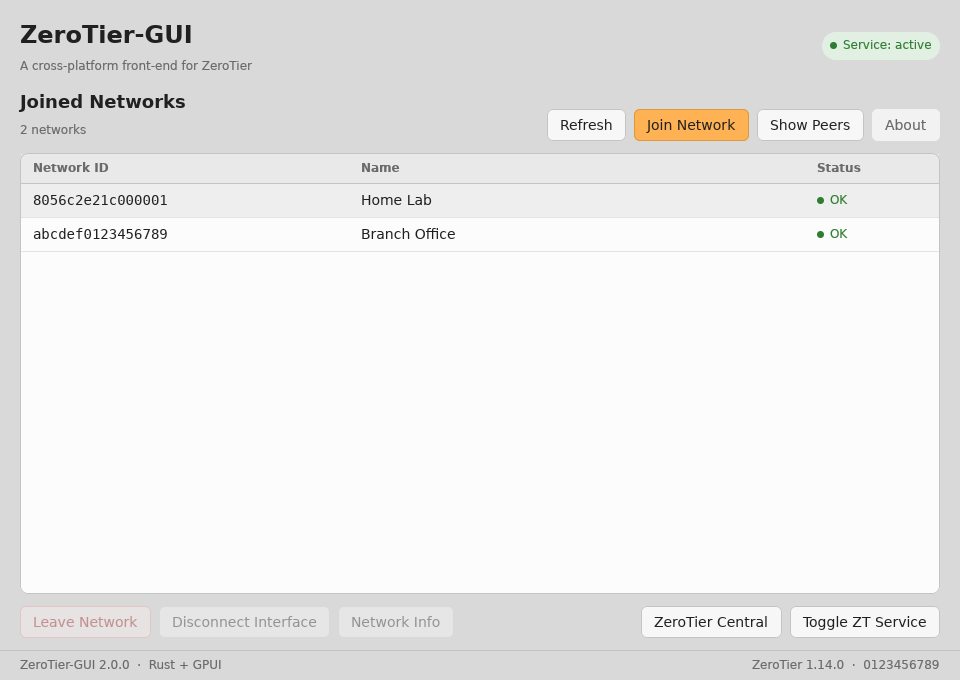
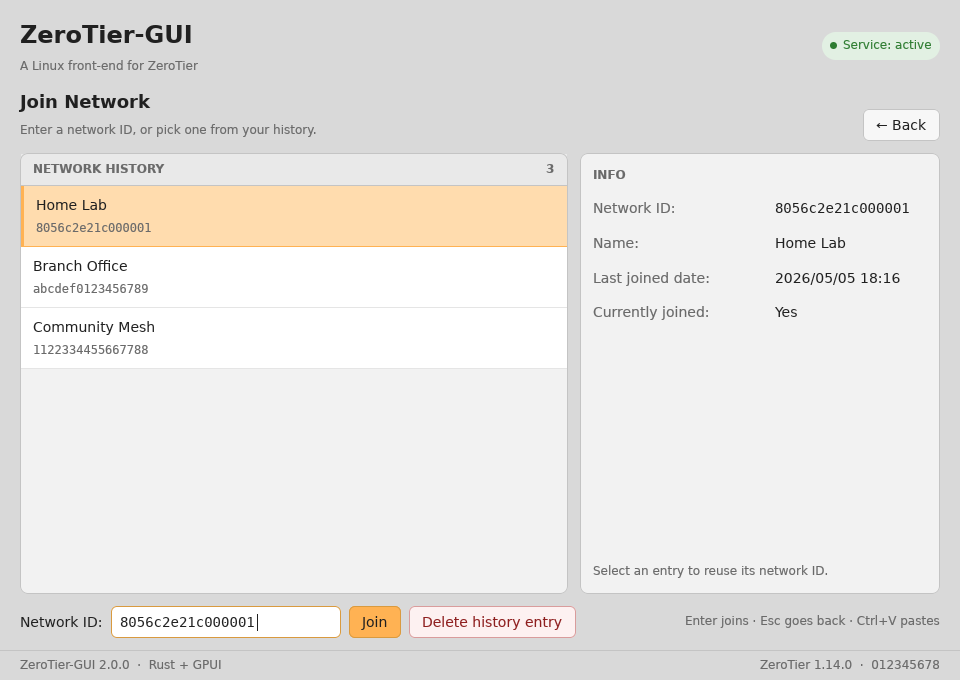
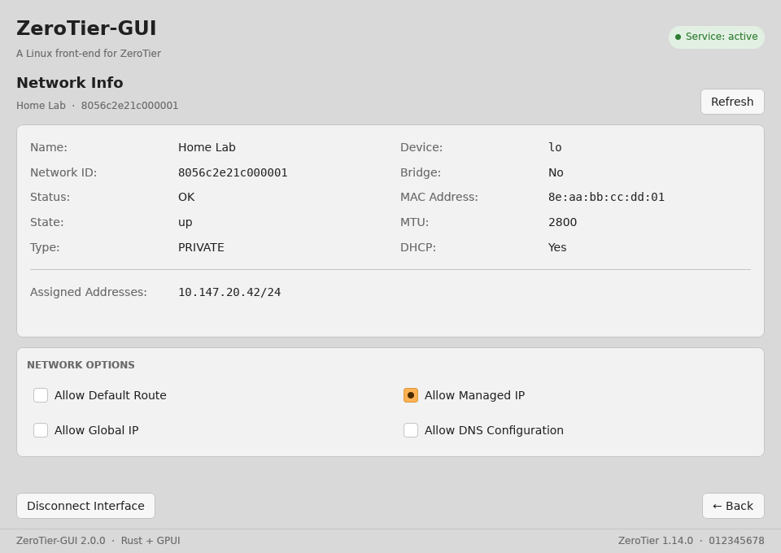
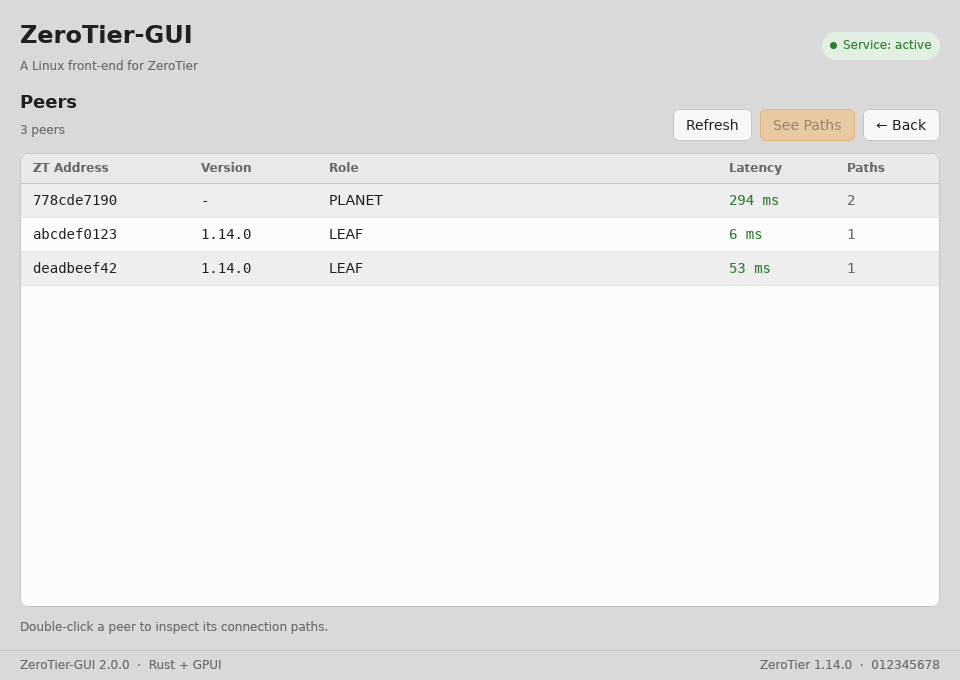
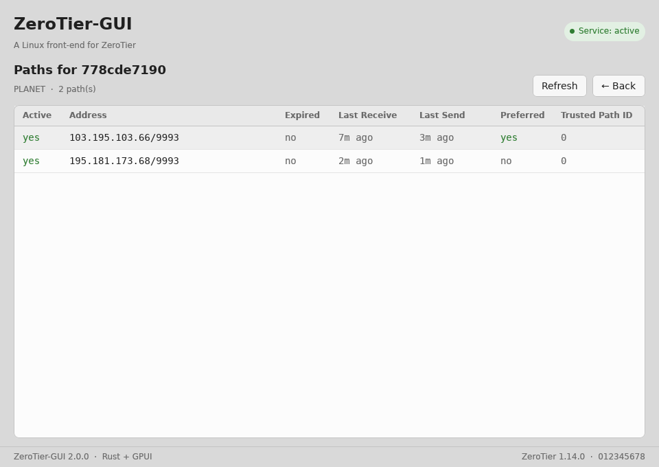

# ZeroTier-GUI (Rust + GPUI) 

[](https://github.com/senasgr-eth/zerotier-gui-rs/actions/workflows/ci.yml)
[](LICENSE)
[](https://www.rust-lang.org/)

**An unofficial, cross-platform desktop front-end for [ZeroTier One](https://www.zerotier.com/), written in Rust with [GPUI](https://gpui.rs/).**

This is a from-scratch reimplementation of the original
[ZeroTier-GUI](https://github.com/tralph3/ZeroTier-GUI) by **Tomás Ralph**.
The original Python/Tkinter application has been dormant for several years;
this rewrite keeps its idea and feature set, but replaces the implementation
with a native Rust binary and a modern GPU-rendered UI.

> ZeroTier is a trademark of ZeroTier, Inc. This project is unofficial and is
> not affiliated with or endorsed by ZeroTier, Inc.

## Screenshots

### Manage networks







### Manage peers





## Features

- List joined networks with network ID, name and controller status.
- Join and leave networks, with a persistent history of previously used IDs.
- Inspect a network: assigned addresses, type, interface, MAC address, MTU,
  DHCP, bridge and interface state.
- Change `allowDefault`, `allowGlobal`, `allowManaged` and `allowDNS` options.
- Bring a ZeroTier interface up or down (Linux).
- Browse peers with their version, role, latency and number of paths.
- Inspect active/expired paths, preferred paths and last send/receive times.
- Start and stop the `zerotier-one` service (Linux/systemd).
- Guided first-run setup for the authentication token and group permissions
  (Linux/polkit).
- Native builds for Linux, macOS and Windows through GitHub Actions.

## Requirements

- [ZeroTier One](https://www.zerotier.com/download/) installed, with
  `zerotier-cli` available on `PATH`.
- Rust **1.88 or newer** (the project uses the 2024 edition and let-chains).
- Linux only, for the full feature set:
  - `systemd` for service management.
  - `polkit`/`pkexec` for starting the service and changing interface state.
  - Either run the app as root, or add your user to the `zerotier-one` group
    and make the authentication token readable. The first-run screen offers to
    do this with `pkexec`.

On macOS and Windows the network, peer and path views work through
`zerotier-cli`; systemd/polkit-specific service, interface and permission
actions are Linux-only.

## Build and run

```sh
git clone https://github.com/senasgr-eth/zerotier-gui-rs.git
cd zerotier-gui-rs
cargo build --release
./target/release/zerotier-gui
```

### Linux build dependencies

GPUI links against the system XKB common libraries on Linux.

**Debian/Ubuntu**

```sh
sudo apt install build-essential libxkbcommon-dev libxkbcommon-x11-dev libxcb1-dev
```

**Fedora**

```sh
sudo dnf install gcc gcc-c++ libxkbcommon-devel libxcb-devel
```

**Arch Linux**

```sh
sudo pacman -S base-devel libxkbcommon libxcb
```

At runtime the binary needs `libxkbcommon0`, `libxkbcommon-x11-0` and `libxcb1`
(installed automatically by the build packages above). GPUI renders through
Vulkan, so make sure your GPU driver provides Vulkan; on Debian/Ubuntu the
Mesa software fallback is `mesa-vulkan-drivers`.

### macOS

Install the Xcode command line tools, then:

```sh
cargo build --release
```

The binary is at `target/release/zerotier-gui`. CI also packages a
`ZeroTier-GUI.app` bundle. Builds are unsigned; on first launch use
right-click → Open, or remove the quarantine attribute:

```sh
xattr -dr com.apple.quarantine ZeroTier-GUI.app
```

### Windows

Install the Rust MSVC toolchain and ZeroTier One, then:

```powershell
cargo build --release
.\target\release\zerotier-gui.exe
```

## Development

```sh
cargo fmt --check
cargo clippy --all-targets -- -D warnings
cargo test
cargo run
```

The UI lives in `src/app.rs`, shared widgets and colours in `src/theme.rs`,
the ZeroTier command-line wrapper in `src/zerotier.rs`, and the persistent
network history in `src/history.rs`.

## CI and releases

- Every push and pull request builds and tests on Linux, macOS and Windows
  (`.github/workflows/ci.yml`).
- Tags matching `v*` produce downloadable archives for Linux, macOS and
  Windows (`.github/workflows/release.yml`).

No distribution-specific package (`.deb`, `.rpm`, …) is produced by this
repository. The Linux archive contains the binary, desktop entry and icon.

## Credits and license

This project is licensed under the **GNU General Public License v3.0 or later**,
the same license as the original ZeroTier-GUI.

- **Original ZeroTier-GUI**: Copyright (C) 2023 Tomás Ralph —
  [tralph3/ZeroTier-GUI](https://github.com/tralph3/ZeroTier-GUI). The original
  idea, feature set and Python/Tkinter implementation belong to that project.
- **Rust + GPUI rewrite**: Copyright (C) 2026 Senasgr.

You are free to use, study, modify and redistribute this software under the
GPL. If you publish a modified version, keep the license and the attribution
notices in [NOTICE](NOTICE), and make the source available. You may take credit
for your own rewrite, but not for the original application or its design.

See [LICENSE](LICENSE) and [NOTICE](NOTICE) for details.
